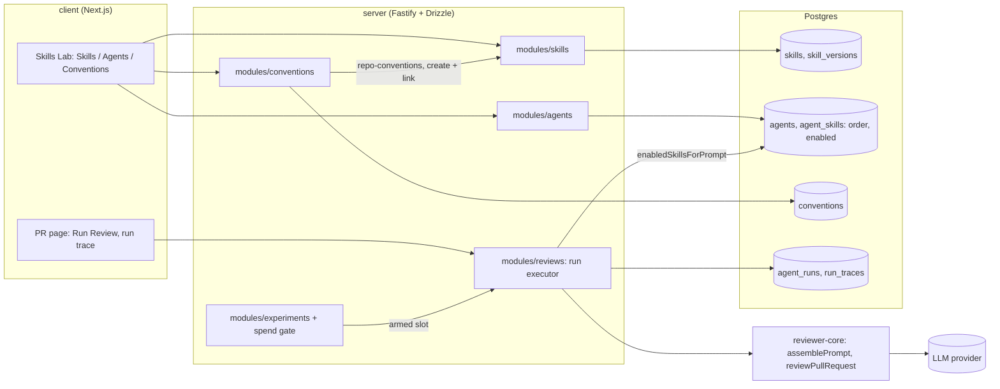

# L02 architecture: Skills, Agents, Conventions and the review run

This page covers only what L02 adds. The system as a whole is described in the
[architecture overview](../../architecture/00_ARCHITECTURE_OVERVIEW.md) and the
[product boundary](../../ai-context/01_PRODUCT_BOUNDARY.md). The package docs
under `server/docs/`, `reviewer-core/docs/` and `client/docs/` hold the
details.

## Skills

- **Storage.** `skills` holds a skill and `skill_versions` holds an immutable
  snapshot per edit (`modules/skills/repository.ts`). Restore appends a new
  version with the old body under a row lock, so history is never rewritten.
- **Provenance.** `source` is `manual`, `imported_file` (the Import drawer) or
  `extracted` (conventions).
- **Listing.** `GET /skills` returns `agent_count`, the number of linked
  agents. `used_by_count` carries the same value for older consumers.

## Agents and links

- **Links.** `agent_skills(agent_id, skill_id, order, enabled)`. A link
  attaches a skill to an agent; `order` is its position; `enabled` is the
  per-agent switch (migration `0012_outstanding_roxanne_simpson`).
- **Write path.** Every link write locks the agent row first, enforces the
  4-skill limit and keeps each surviving link's switch through a reorder
  (`modules/_shared/agent-skill-links.ts`). A disabled link still counts
  toward the limit.
- **API.**
  - `POST /agents/:id/skills` sets or reorders the links.
  - `PATCH /agents/:id/skills/:skillId` flips one link's switch.
- **UI.** The Skills tab (`AgentEditor/_components/SkillsTab.tsx`) lists every
  skill, with a link toggle and a category badge on each row. Linked rows also
  get the per-agent switch. Native drag-and-drop works only on rows that are
  linked, on for the agent, and enabled.

## Prompt assembly and the run trace

1. `AgentsRepository.enabledSkillsForPrompt` selects the agent's links whose
   skill is enabled **and** whose link is on, ordered by `agent_skills.order`.
2. The executor (`modules/reviews/run-executor.ts`) passes those bodies to
   `reviewer-core`.
3. `assemblePrompt` (`reviewer-core/src/prompt.ts`) renders them as one
   `## Skills / rules` section, each body fenced as untrusted data
   (`<untrusted source="skill-N">`). It sits after the PR description and
   before the repo context and the diff.
4. `skills_tokens` is the tokenizer count (js-tiktoken) of exactly that
   section. It is stored in the run trace's prompt assembly and shown on the
   Skills block in the trace drawer. With no enabled skill there is no block
   and no count.

## Conventions

1. `POST /repos/:id/conventions/extract` selects samples in plain code: config
   files (`CONFIG_SAMPLE_PATHS`) plus the top 12 files from
   `repoIntel.getConventionSamples()`.
2. It makes one structured model call (the Conventions feature model chosen in
   Settings) returning `{category, rule, evidence file + line, confidence}`.
3. Candidates are grounded against the sampled lines and stored in
   `conventions` with a `status`: pending, accepted or rejected.
4. Accepted candidates merge into a draft skill named `repo-conventions`. The
   draft's body and metadata stay editable. It is created and linked to the
   chosen agent in one transaction.

## Experiments

See [EXPERIMENTS.md](EXPERIMENTS.md).
- An experiment stack wraps every LLM provider in a spend gate. The only paid
  generation it allows is the authorized request of the single open slot.
- A slot is dispatched directly or, for criteria 17 and 18, by arming it and
  clicking Run Review on the PR page.
- The runner keeps a shared, fsynced ledger and settles against the key's own
  usage.
