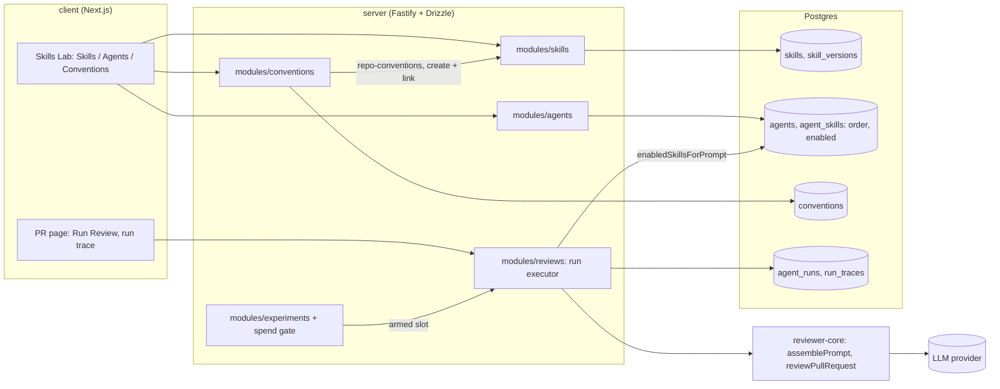
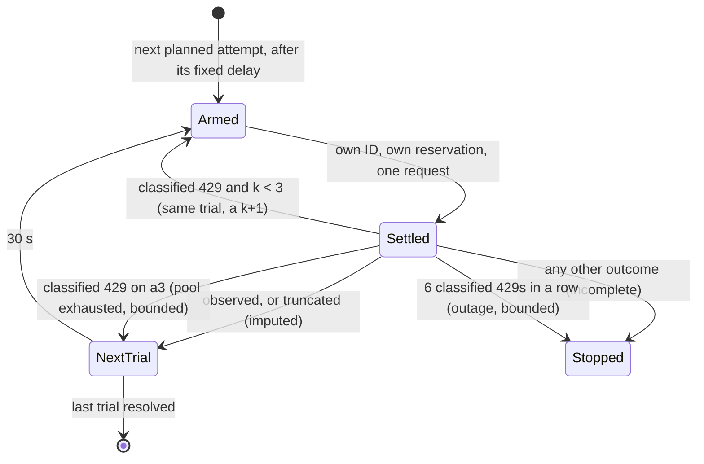

# L02 architecture: Skills, Agents, Conventions and the review run

This page covers only what L02 adds. The system as a whole is described in the
[architecture overview](../../architecture/00_ARCHITECTURE_OVERVIEW.md) and the
[product boundary](../../ai-context/01_PRODUCT_BOUNDARY.md). The package docs
under `server/docs/`, `reviewer-core/docs/` and `client/docs/` hold the
details.

## Skills

- **Storage.** `skills` holds a skill and `skill_versions` holds an immutable
  snapshot per edit (`modules/skills/repository.ts`). Restore appends a new
  version with the old body under a row lock, so history is never rewritten.
- **Provenance.** `source` is `manual`, `imported_file` (the Import drawer) or
  `extracted` (conventions).
- **Listing.** `GET /skills` returns `agent_count`, the number of linked
  agents. `used_by_count` carries the same value for older consumers.

## Agents and links

- **Links.** `agent_skills(agent_id, skill_id, order, enabled)`. A link
  attaches a skill to an agent; `order` is its position; `enabled` is the
  per-agent switch (migration `0012_outstanding_roxanne_simpson`).
- **Write path.** Every link write locks the agent row first, enforces the
  4-skill limit and keeps each surviving link's switch through a reorder
  (`modules/_shared/agent-skill-links.ts`). A disabled link still counts
  toward the limit.
- **API.**
  - `POST /agents/:id/skills` sets or reorders the links.
  - `PATCH /agents/:id/skills/:skillId` flips one link's switch.
- **UI.** The Skills tab (`AgentEditor/_components/SkillsTab.tsx`) lists every
  skill, with a link toggle and a category badge on each row. Linked rows also
  get the per-agent switch. Native drag-and-drop works only on rows that are
  linked, on for the agent, and enabled.

## Prompt assembly and the run trace

Changed on 2026-10-30 after the mentor's ruling on criterion 14: Skill bodies
go in the literal **system-role** message, and only owner-approved content
may get there.

1. `AgentsRepository.enabledSkillsForPrompt` selects the agent's links whose
   skill is enabled **and** whose link is on, ordered by `agent_skills.order`
   (the drag order), with each skill's approval state.
2. The executor (`modules/reviews/run-executor.ts`, `buildSkillBlocks`) fails
   the run **before any model request** if one of those skills is not
   approved, its approval is stale or revoked, or the approval lookup fails
   (`409 skill_not_approved`). Disabled skills are never loaded, so they
   need no approval. Otherwise it passes the bodies to `reviewer-core`.
3. `assemblePrompt` (`reviewer-core/src/prompt.ts`) builds:
   - **system message:** the agent's trusted instructions, then the
     `## Skills / rules` section from `renderSkillsSection` (each body fenced
     as `<untrusted source="skill-N">`, closing tags escaped regardless of
     case or whitespace), then the trusted injection guard, last;
   - **user message:** task, PR description, memory, repo skeleton, project
     context, callers and the diff.

   A review with no enabled skill produces byte-for-byte the same messages
   as before. Single-pass and every map chunk use the same assembler.
   Fencing and the guard are a policy the model is asked to follow, not a
   guarantee of injection resistance; the approval gate, output-schema
   validation and grounding remain the enforced controls.
4. `skills_tokens` is the tokenizer count (js-tiktoken) of exactly that
   section, rendered once by the same function. It is stored in the run
   trace's prompt assembly and shown on the separate Skills block in the
   trace drawer, labelled as part of the system message. With no enabled
   skill there is no block and no count. Traces written before the change
   (Skills in the user message) render with a legacy label.

## Run lifecycle evidence and failure traces (2026-11-01)

Item B v3 showed that a failed run's trace did not record what was sent. The
failure path wrote the agent's raw prompt, no Skills and zero usage, while
the run row held the billed tokens. The repair, in
`reviewer-core/src/review/run.ts`, `reviewer-core/src/llm/lifecycle.ts`,
`server/src/modules/reviews/{run-executor,trace-recorder,repository}.ts`
and `server/src/modules/_shared/trace-evidence.ts`, works as follows.

1. **Stages.** The engine reports each stage just before its provider call,
   with the exact `PromptAssembly` it sends:
   - stage IDs `single-0` or `map-N`;
   - reduce is deterministic and sends no request.

   Stages are kept in order in `stages[]`. Each holds its state, usage,
   attempts and an assembly digest. Each distinct full assembly is stored
   once, bounded at 256 KiB per copy and 1 MiB per trace. If a copy is cut,
   `assembly_complete: false` is set and the byte count and sha256 of the
   full text are kept.
2. **Attempts.** Each adapter records attempts under the stage:
   - OpenRouter, both the normal and the experiment path;
   - OpenAI;
   - Anthropic.

   An attempt moves through `submitted` (handed to the HTTP client),
   `response_received` (with a provider response ID, usage and reasoning
   tokens) and `usage_verified` (a generation record found), or ends
   `failed`. A structured retry is another attempt under the same stage.
   `submitted` is never treated as proof that the provider processed the
   request. SDK-internal transport retries are not visible.
3. **Dispatch classification.** `dispatch.state` is one of
   `not_dispatched`, `dispatched` or `completed`. A refusal before
   dispatch is recorded with an explicit code, zero attempts and
   `usage_state: 'none'`, and no prompt is invented for it. The codes are
   `skill_not_approved`, `experiment_refused`,
   `experiment_spend_refused`, `strategy_guard`, `config_error`,
   `diff_unavailable` and others.
4. **Truncated and schema-invalid output.** These raise a typed
   `ProviderOutputError`. It carries the partial text, bounded to 16 KiB,
   plus usage, the finish reason and the response ID. The trace stores this
   as `partial_output` (`provider_incomplete: true`); it is never parsed
   into findings. Prompts and partial output are stored only in
   `run_traces`, behind the workspace-scoped trace route, and never in logs
   or the run bus. Provider IDs and error text are sanitized and bounded
   before they reach any record or log.
5. **One set of totals.** The run row and the trace stats come from the same
   totals. Unknown usage stays `null`, never 0. The global experiment
   ledger stays authoritative for billing; a null cost is charged the full
   reservation.
6. **Atomic persistence.**
   - The terminal row update and the trace are written in one transaction
     on both the success and the failure path.
   - Postgres-invalid text (U+0000, lone surrogates) is replaced before the
     write, through a depth-bounded walk.
   - If the full failure trace still cannot be written, one retry writes a
     minimal labelled trace (`persistence: 'fallback'`).
   - A cancel through the API keeps its status; the measured usage is
     filled into the row under a guarded update.
   - The boot reaper labels runs that crashed or were cancelled without a
     trace (`persistence: 'reaped'`, prompt `unrecorded`). It keeps any
     persisted usage and partial trace, and fabricates nothing.
7. **Legacy traces.** A trace written before this change has no
   `prompt_assembly_source`. It is classified at read time and never
   rewritten:
   - `legacy_single_pass`;
   - `legacy_map_reduce_whole_diff`;
   - `legacy_failed_fallback`.

   A new trace whose top-level prompt was cut reads as
   `dispatched_request_incomplete`. The HW2 report and the experiment slot
   view use this classification. A legacy failed trace reads as "prompt not
   recorded", never as "sent 0 skills", and a cut prompt never counts as
   proof of the Skills section.

The system-role Skill placement, the approval gate, the enabled-Skill
filter, the drag order and `skills_tokens` are unchanged. All new trace
fields are optional, so stored traces still validate; both contract copies
match. The run-trace drawer shows the persisted run status
(`RunSummary.status`) in its header.

## Skill content approval

- **Rule.** A skill is approved only if its latest decision is `approve` and
  names its current version **and** the SHA-256 of its exact current body
  (`modules/_shared/skill-approval.ts`). Any edit, rename or restore bumps the
  version and makes it `stale` with no write; `revoke` makes it `revoked`.
  Create, import, conventions "create skill", link and enable never approve.
- **Who.** `POST /skills/:id/approval {version, body_sha256, reason?}` and
  `DELETE /skills/:id/approval` require the caller to be a workspace `owner`
  (403 otherwise; 404 for another workspace; 409 when the reviewed version or
  digest is no longer current). Under the MVP's `LocalNoAuthProvider` every
  local caller is the seeded owner, so the 403 path is enforced and tested
  but cannot occur locally.
- **Audit.** `skill_approvals` (migration `0013_clammy_hellion`) is
  append-only in application code and keeps `skill_name`; deleting a skill
  sets `skill_id` to null instead of deleting its history.
  `GET /skills/:id/approvals` lists the decisions.
- **Seeded skills.** `server/src/db/reviewed-seed-skills.ts` lists the SHA-256
  of seven seeded bodies that were read for injection-style text. The seed
  approves a seeded skill only if its stored body matches that digest and it
  has no earlier decision, so it never overrides an owner's revoke. The
  import-only `deprecation-policy` stays unapproved. After migrating an
  existing database, run `pnpm db:seed`.
- **UI.** Skill cards and the editor show "Approved for system prompt"
  separately from Enabled. The Preview tab's approval panel shows the exact
  raw body (not rendered Markdown), version and full digest, and approves
  only that. The agent's Skills tab marks each row and warns when an enabled
  skill blocks reviews.

## Conventions

1. `POST /repos/:id/conventions/extract` selects samples in plain code: config
   files (`CONFIG_SAMPLE_PATHS`) plus the top 12 files from
   `repoIntel.getConventionSamples()`.
2. It makes one structured model call (the Conventions feature model chosen in
   Settings) returning `{category, rule, evidence file + line, confidence}`.
3. Candidates are grounded against the sampled lines and stored in
   `conventions` with a `status`: pending, accepted or rejected.
4. Accepted candidates merge into a draft skill named `repo-conventions`. The
   draft's body and metadata stay editable. It is created and linked to the
   chosen agent in one transaction.

## Experiments

See [EXPERIMENTS.md](EXPERIMENTS.md).
- An experiment stack wraps every LLM provider in a spend gate. The only paid
  generation it allows is the authorized request of the single open slot.
- A slot is dispatched directly or, for criteria 17 and 18, by arming it and
  clicking Run Review on the PR page.
- The runner keeps a shared, fsynced ledger and settles against the key's own
  usage.

### Study v5: the P3 attempt pool (runner support, not authorized)

A version 5 manifest (`STUDY_V5`, `itemb-v5`, tag `v5`) freezes the v4 #17
design plus the owner-approved 429 policy from the
[proposal](proposals/429-policy-proposal.md): K = 3 attempts per trial,
M = 30 attempts in total, an outage stop after L = 6 classified 429s in a row,
pacing of 30 s between trials and 60 s / 180 s before a2 / a3, P4 reporting
and no warm-ups. Versions 3 and 4 behave exactly as before; each version
accepts only its own study block. The code is in
`server/src/experiments/hw2/attempt-policy.ts`, `runner.ts`
(`runAttemptPool`) and `report-p3.ts`. Nothing here authorizes spending.

- **Plan.** The manifest freezes the trials (seeded as in v4) and all 30
  attempt IDs `c-v5-17-<condition>-<trial>-a<k>` with their delays. A trial
  ID is never dispatched. The capability budget must cover M × the
  per-attempt reservation (`authorize` refuses less), and `plan` prints both.
- **Classification.** `throttleProblems` reads structured fields only: one
  dispatched attempt, numeric HTTP 429, origin `upstream_provider`,
  `limit_source` exactly `upstream_provider_shared_pool`, the frozen provider
  name, and no response ID, generation ID, usage or cost. Anything else, an
  OpenRouter-side 429 included, is a failure that stops the study.
- **Stops.** Every existing confirmatory stop still applies: a refusal, a
  fingerprint mismatch, unknown cost, and a provenance gap on an observed
  attempt (strict eligibility). The only exception is that a classified 429
  neither counts toward nor resets the consecutive unknown-cost and
  infrastructure counters. A 429's reservation stays charged in full.
- **Restart.** A restarted runner rebuilds the protocol state from the
  ledger alone. It refuses any history the protocol could not have produced,
  checked with `traceProblems` in its in-progress form. It classifies a
  reconciled attempt again from the stack's record. It never reuses an
  attempt ID.
- **Report and adjudication.** Each attempt shows its UTC armed, submitted
  and finished times, its class (re-derived from the trace and compared with
  the ledger), and every 429's position and condition. Each trial is labelled
  `observed`, `imputed`, `bounded` (lost to classified 429s only) or
  `incomplete`. The strict result is reported apart from the worst- and
  best-case bounds, with the missingness balance. A claim beyond `incomplete`
  needs every missing trial to be `bounded`. A worst-case success is a
  conditional bound, never a verified result. The packet stays one case per
  observed trial. The private mapping holds the attempt pools, and the reveal
  applies the same P4 rule to the adjudicated verdicts.

## One-use extraction authorization

The isolated conventions experiment reuses the existing extraction endpoint
and guarded OpenRouter adapter. Before a capability token can be used,
`authorizeExtraction` fsyncs an `authorization_intent` containing the slot,
request and capability digests; then it writes the private capability and
token. A crash leaves an audit trail and a consumed slot rather than an
unlogged usable grant. Authorization holds the shared runner lock while it
checks the ledger, and extraction preflight prices only the exact pinned
provider tag. The endpoint records attempt telemetry and the private raw and
parsed response before checking provenance; unverified responses do not
persist candidates. The global ledger remains the spending authority, while
one-use receipts describe operation progress. See
[CONVENTIONS-EXTRACTION-PREFLIGHT.md](CONVENTIONS-EXTRACTION-PREFLIGHT.md).
