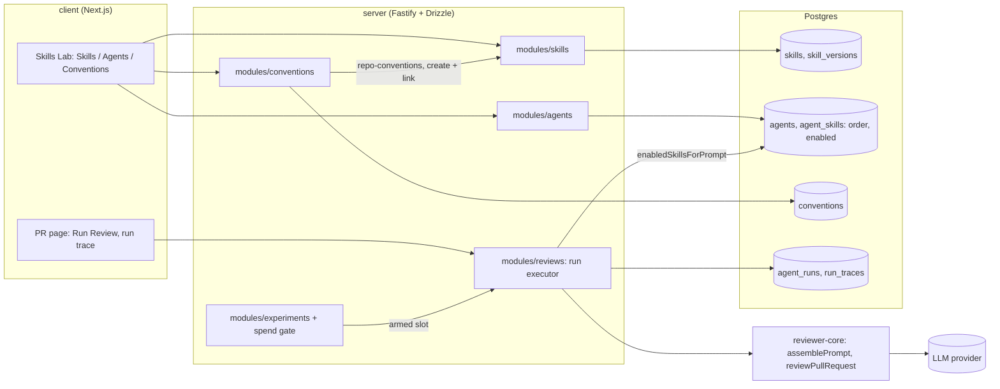

# L02 architecture: Skills, Agents, Conventions and the review run

This page covers only what L02 adds. The system as a whole is described in the
[architecture overview](../../architecture/00_ARCHITECTURE_OVERVIEW.md) and the
[product boundary](../../ai-context/01_PRODUCT_BOUNDARY.md). The package docs
under `server/docs/`, `reviewer-core/docs/` and `client/docs/` hold the
details.

## Skills

- **Storage.** `skills` holds a skill and `skill_versions` holds an immutable
  snapshot per edit (`modules/skills/repository.ts`). Restore appends a new
  version with the old body under a row lock, so history is never rewritten.
- **Provenance.** `source` is `manual`, `imported_file` (the Import drawer) or
  `extracted` (conventions).
- **Listing.** `GET /skills` returns `agent_count`, the number of linked
  agents. `used_by_count` carries the same value for older consumers.

## Agents and links

- **Links.** `agent_skills(agent_id, skill_id, order, enabled)`. A link
  attaches a skill to an agent; `order` is its position; `enabled` is the
  per-agent switch (migration `0012_outstanding_roxanne_simpson`).
- **Write path.** Every link write locks the agent row first, enforces the
  4-skill limit and keeps each surviving link's switch through a reorder
  (`modules/_shared/agent-skill-links.ts`). A disabled link still counts
  toward the limit.
- **API.**
  - `POST /agents/:id/skills` sets or reorders the links.
  - `PATCH /agents/:id/skills/:skillId` flips one link's switch.
- **UI.** The Skills tab (`AgentEditor/_components/SkillsTab.tsx`) lists every
  skill, with a link toggle and a category badge on each row. Linked rows also
  get the per-agent switch. Native drag-and-drop works only on rows that are
  linked, on for the agent, and enabled.

## Prompt assembly and the run trace

Changed on 2026-10-30 after the mentor's ruling on criterion 14: Skill bodies
go in the literal **system-role** message, and only owner-approved content
may get there.

1. `AgentsRepository.enabledSkillsForPrompt` selects the agent's links whose
   skill is enabled **and** whose link is on, ordered by `agent_skills.order`
   (the drag order), with each skill's approval state.
2. The executor (`modules/reviews/run-executor.ts`, `buildSkillBlocks`) fails
   the run **before any model request** if one of those skills is not
   approved, its approval is stale or revoked, or the approval lookup fails
   (`409 skill_not_approved`). Disabled skills are never loaded, so they
   need no approval. Otherwise it passes the bodies to `reviewer-core`.
3. `assemblePrompt` (`reviewer-core/src/prompt.ts`) builds:
   - **system message:** the agent's trusted instructions, then the
     `## Skills / rules` section from `renderSkillsSection` (each body fenced
     as `<untrusted source="skill-N">`, closing tags escaped regardless of
     case or whitespace), then the trusted injection guard, last;
   - **user message:** task, PR description, memory, repo skeleton, project
     context, callers and the diff.

   A review with no enabled skill produces byte-for-byte the same messages
   as before. Single-pass and every map chunk use the same assembler.
   Fencing and the guard are a policy the model is asked to follow, not a
   guarantee of injection resistance; the approval gate, output-schema
   validation and grounding remain the enforced controls.
4. `skills_tokens` is the tokenizer count (js-tiktoken) of exactly that
   section, rendered once by the same function. It is stored in the run
   trace's prompt assembly and shown on the separate Skills block in the
   trace drawer, labelled as part of the system message. With no enabled
   skill there is no block and no count. Traces written before the change
   (Skills in the user message) render with a legacy label.

## Skill content approval

- **Rule.** A skill is approved only if its latest decision is `approve` and
  names its current version **and** the SHA-256 of its exact current body
  (`modules/_shared/skill-approval.ts`). Any edit, rename or restore bumps the
  version and makes it `stale` with no write; `revoke` makes it `revoked`.
  Create, import, conventions "create skill", link and enable never approve.
- **Who.** `POST /skills/:id/approval {version, body_sha256, reason?}` and
  `DELETE /skills/:id/approval` require the caller to be a workspace `owner`
  (403 otherwise; 404 for another workspace; 409 when the reviewed version or
  digest is no longer current). Under the MVP's `LocalNoAuthProvider` every
  local caller is the seeded owner, so the 403 path is enforced and tested
  but cannot occur locally.
- **Audit.** `skill_approvals` (migration `0013_clammy_hellion`) is
  append-only in application code and keeps `skill_name`; deleting a skill
  sets `skill_id` to null instead of deleting its history.
  `GET /skills/:id/approvals` lists the decisions.
- **Seeded skills.** `server/src/db/reviewed-seed-skills.ts` lists the SHA-256
  of seven seeded bodies that were read for injection-style text. The seed
  approves a seeded skill only if its stored body matches that digest and it
  has no earlier decision, so it never overrides an owner's revoke. The
  import-only `deprecation-policy` stays unapproved. After migrating an
  existing database, run `pnpm db:seed`.
- **UI.** Skill cards and the editor show "Approved for system prompt"
  separately from Enabled. The Preview tab's approval panel shows the exact
  raw body (not rendered Markdown), version and full digest, and approves
  only that. The agent's Skills tab marks each row and warns when an enabled
  skill blocks reviews.

## Conventions

1. `POST /repos/:id/conventions/extract` selects samples in plain code: config
   files (`CONFIG_SAMPLE_PATHS`) plus the top 12 files from
   `repoIntel.getConventionSamples()`.
2. It makes one structured model call (the Conventions feature model chosen in
   Settings) returning `{category, rule, evidence file + line, confidence}`.
3. Candidates are grounded against the sampled lines and stored in
   `conventions` with a `status`: pending, accepted or rejected.
4. Accepted candidates merge into a draft skill named `repo-conventions`. The
   draft's body and metadata stay editable. It is created and linked to the
   chosen agent in one transaction.

## Experiments

See [EXPERIMENTS.md](EXPERIMENTS.md).
- An experiment stack wraps every LLM provider in a spend gate. The only paid
  generation it allows is the authorized request of the single open slot.
- A slot is dispatched directly or, for criteria 17 and 18, by arming it and
  clicking Run Review on the PR page.
- The runner keeps a shared, fsynced ledger and settles against the key's own
  usage.

## One-use extraction authorization

The isolated conventions experiment reuses the existing extraction endpoint
and guarded OpenRouter adapter. Before a capability token can be used,
`authorizeExtraction` fsyncs an `authorization_intent` containing the slot,
request and capability digests; then it writes the private capability and
token. A crash leaves an audit trail and a consumed slot rather than an
unlogged usable grant. Authorization holds the shared runner lock while it
checks the ledger, and extraction preflight prices only the exact pinned
provider tag. The endpoint records attempt telemetry and the private raw and
parsed response before checking provenance; unverified responses do not
persist candidates. The global ledger remains the spending authority, while
one-use receipts describe operation progress. See
[CONVENTIONS-EXTRACTION-PREFLIGHT.md](CONVENTIONS-EXTRACTION-PREFLIGHT.md).
