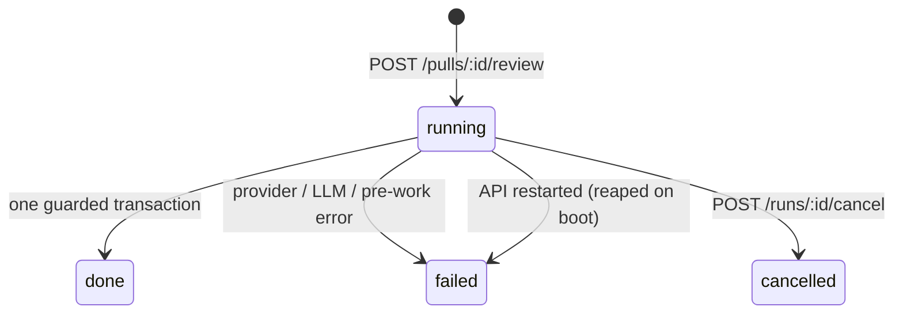

# Review runs

How one click on **Run Review** becomes persisted runs, reviews, findings, and
traces. The engine itself (prompt, LLM call, grounding, score) is
reviewer-core's; see
[`../../reviewer-core/docs/review-engine.md`](../../reviewer-core/docs/review-engine.md).
The full route list is in [`../README.md`](../README.md#api-map-starter). How PR
intent is derived and cached is in the
[architecture overview](../../docs/architecture/00_ARCHITECTURE_OVERVIEW.md#prompt-construction-and-trust-model).

## Request path

`POST /pulls/:id/review` takes `{ agentId }` or `{ all: true }`
([`src/modules/reviews/routes.ts`](../src/modules/reviews/routes.ts)). It is
rate-limited to 10 per minute.

1. `ReviewService.resolveTargets` picks one agent, or every enabled agent
   (`service.ts:47`).
2. `ReviewService.runReview` (`service.ts:116`) creates one `agent_runs` row per
   target **up front**, with `status='running'` (`service.ts:135`,
   `repository/run.repo.ts:148`). The response therefore already carries every
   `run_id`, and the client can subscribe to SSE immediately.
3. It starts `ReviewRunExecutor.executeRuns` **fire-and-forget**
   (`service.ts:148`) and returns `{ pr_id, runs, reviews: [] }`. The HTTP
   request awaits nothing from the review itself.

## Execution

`executeRuns` lives in
[`src/modules/reviews/run-executor.ts`](../src/modules/reviews/run-executor.ts).

### Shared pre-work, once per batch

1. **Load the diff.** `loadDiff`
   ([`diff-loader.ts`](../src/modules/reviews/diff-loader.ts)) prefers
   `git diff base...head` from the clone. If that fails, it rebuilds a unified
   diff from the persisted `pr_files` patches.
2. **Resolve one PR intent for the whole batch** (`run-executor.ts:154`). A
   fresh cached intent is reused; a missing or stale one is derived once. If
   derivation fails, the batch reviews without intent; this step never throws.
   Experiment runs never derive, because derivation is a paid call.

If the diff cannot be loaded, **every** queued run is marked `failed` and keeps
its buffered log (`failAll`).

### Per agent

The agents of a batch run **sequentially**, not in parallel. One agent's
failure is isolated and does not stop the others. For each agent:

1. **Resolve the provider.** A missing provider key surfaces as a failed run.
2. **Build the prompt input** (`buildPromptInput`, `run-executor.ts:449`):
   - The agent's **enabled linked skills**, in link order
     (`buildSkillBlocks`, `run-executor.ts:531`). A lookup failure degrades to
     no skills.
   - Optional **repo-intel context**: the callers digest, the repo map, and the
     rank note. These are skipped when the agent's `repo_intel` toggle is off,
     and they degrade silently when the repository is not indexed.
   - The **PR body** and the batch's **intent**, both of which reviewer-core
     treats as untrusted.
3. **Call the engine.** `reviewPullRequest` runs with the agent's model and
   strategy, and with `checkCancelled` wired to `checkpoint(runId)`.
4. **Count blockers** deterministically: findings at or above the agent's
   `ci_fail_on` gate. This count, not the model's verdict, colors the
   Timeline.
5. **Persist atomically.** `finalizeRunSuccess` (`run-executor.ts:286`) writes,
   in **one transaction guarded on `status = 'running'`**:
   - the run moves to `done` with its duration, tokens, provider-reported cost,
     finding count, grounding, score, and blockers;
   - a `reviews` row with `agent_id` and `run_id`;
   - the grounded findings;
   - the PR's `last_reviewed_sha`, which drives the PR-list status.

   If a cancel landed after the model returned, nothing is written and the run
   stays `cancelled`.
6. **Save the trace and close the stream.** One `run_traces` JSON document is
   saved. It holds the prompt assembly with the Skills token count and an
   immutable copy of the intent this run used. Then
   `runBus.complete(runId)` ends the stream.

## Run states

- **Terminal writes compare and set from `running`** (`repository/run.repo.ts:196`).
  A late success or failure therefore never overwrites a cancel.
- **Failure and cancel** persist the status, the error text, `cost_usd = null`,
  and the log so far as a minimal trace, so the reason survives a reload.
- **Cancel** (`ReviewService.cancelRun`, `service.ts:86`):
  1. It checks ownership first: a run from another workspace gets a 404, and
     neither the stream nor the bus hears about it.
  2. It sets the in-memory flag on the bus.
  3. It moves the row from `running` to `cancelled`.
  4. It completes the stream.

  Cancelling therefore also works for an orphaned run.
- **Checkpoints** (`checkpoint`, `run-executor.ts:524`) run before every model
  call and before persisting. The bus flag is only a fast path: completing the
  stream clears it. The durable `agent_runs.status = 'cancelled'` is the
  authoritative signal.
- **Reaping:** on boot, every `running` row becomes `failed`
  (`repository/run.repo.ts:136`); see
  [architecture → boot sequence](architecture.md#boot-sequence).

## Live events and traces

`RunBus` ([`src/platform/sse.ts`](../src/platform/sse.ts)) keeps an in-memory
buffer of `RunEvent`s per run:

- **Replay first:** `GET /runs/:id/events` subscribes and replays the buffer
  before any live events, so a subscriber that arrives late, or after
  completion, still sees the whole log. The stream ends when the run completes.
- **Persisted log:** events published after completion are still buffered,
  because the persisted trace is built from the buffer.
- **After a restart:** the bus is process-local, so only the persisted trace
  remains, served by `GET /runs/:id/trace`.
- **Workspace scope:** both routes return 404 for a run in another workspace.

## Cost

`agent_runs.cost_usd` stores only the **provider-reported** USD cost from
reviewer-core (`outcome.providerCostUsd`). It is null whenever any model call
did not report one, and it is never a token-price estimate (see
[`../../reviewer-core/specs/01-provider-cost.md`](../../reviewer-core/specs/01-provider-cost.md)).
The PR list sums it across distinct successful runs; see
[PR list summary](pr-list-summary.md).

## Experiment runs

The HW2 experiment runner reuses this path with an `experiment` context
([`experiment-run.ts`](../src/modules/reviews/experiment-run.ts)). Before
dispatching, a slot checks the diff hash, the cached intent, the agent, the
clone, the endpoints, and the preflight. It records an `experiment` block in
the trace. The runner is opt-in; the plain studio flow never takes this path.

## Reading the results

| Route | Returns |
| --- | --- |
| `GET /pulls/:id/runs` | Every run of the PR (any status), newest first: the Timeline. |
| `GET /pulls/:id/runs/active` | Runs still `running`; the client polls this while any exist. |
| `GET /pulls/:id/reviews` | Persisted reviews with their findings and agent names: Review runs. |
| `DELETE /runs/:id`, `DELETE /reviews/:id` | Remove a run (with its trace) or a review (findings cascade). |
| `POST /findings/:id/accept\|dismiss` | Local finding disposition; nothing is posted to GitHub. |

## Tests

- `test/reviews.it.test.ts` (Docker) runs real review requests against
  `MockLLMProvider`. It covers grounding, provider cost, finding actions, SSE
  completion, "run all enabled agents", workspace-scoped run routes, and the
  PR-list matrix.
- `test/run-lifecycle.it.test.ts` covers cancellation and the guarded terminal
  writes.
