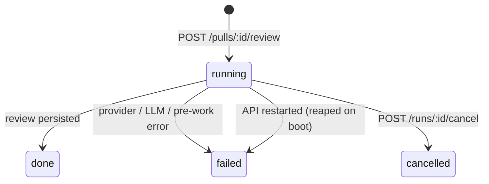

# Review runs

How one click on **Run Review** becomes persisted runs, reviews, findings, and
traces. The engine itself (prompt, LLM call, grounding, score) is
reviewer-core's; see
[`../../reviewer-core/docs/review-engine.md`](../../reviewer-core/docs/review-engine.md).
The full route list is in [`../README.md`](../README.md#api-map-starter).

## Request path

`POST /pulls/:id/review` with `{ agentId }` or `{ all: true }`
([`src/modules/reviews/routes.ts`](../src/modules/reviews/routes.ts); rate-limited
to 10/min):

1. `ReviewService.resolveTargets` picks one agent, or every enabled agent
   (`service.ts:46`).
2. `ReviewService.runReview` (`service.ts:103`) creates one `agent_runs` row per
   target **up front**, with `status='running'` (`repository/run.repo.ts:129`), so
   the response already carries every `run_id` and the client can subscribe to
   SSE immediately.
3. It starts `ReviewRunExecutor.executeRuns` **fire-and-forget**
   (`service.ts:133`) and returns `{ pr_id, runs, reviews: [] }`. Nothing about
   the review is awaited by the HTTP request.

## Execution

`executeRuns` ([`src/modules/reviews/run-executor.ts:55`](../src/modules/reviews/run-executor.ts)):

1. **Shared pre-work, once per batch:** load the diff (`run-executor.ts:98`).
   `loadDiff` ([`diff-loader.ts`](../src/modules/reviews/diff-loader.ts)) prefers
   `git diff base...head` from the clone, and falls back to rebuilding a unified
   diff from the persisted `pr_files` patches. If pre-work fails, **every**
   queued run is marked `failed` with its buffered log (`failAll`,
   `run-executor.ts:75`).
2. **Agents run sequentially**, not in parallel (`run-executor.ts:108`). One
   agent's failure is isolated and does not stop the rest.
3. **Per agent** (`runOneAgent`, `run-executor.ts:139`):
   1. Resolve the agent's LLM provider. A missing key surfaces as a failed run.
   2. Build optional repo-intel context: callers digest, repo map, and rank
      note. Each step is skipped when the agent's `repo_intel` toggle is off,
      and degrades silently when the repository is not indexed.
   3. Call `reviewPullRequest` from reviewer-core (`run-executor.ts:191`) with:
      - the agent prompt and model;
      - the diff;
      - the strategy (single-pass or map-reduce);
      - the untrusted PR body;
      - a `checkCancelled` hook (`run-executor.ts:211`).
   4. **Persist:** a `reviews` row with `agent_id` and `run_id`, and its
      grounded findings (`run-executor.ts:219`).
   5. **Mark reviewed:** stamp the PR's `last_reviewed_sha`, which drives the
      PR-list status (`run-executor.ts:235`).
   6. **Count blockers** deterministically: findings at or above the agent's
      `ci_fail_on` gate (`run-executor.ts:241`). This, not the model's verdict,
      colors the Timeline.
   7. **Complete the run:** `status='done'`, duration, tokens,
      provider-reported cost, finding count, grounding, score, and blockers
      (`run-executor.ts:244`).
   8. **Save the trace and close the bus:** one `run_traces` JSON document
      (`run-executor.ts:289`), then `runBus.complete(runId)`.

## Run states

- **Failure and cancel** persist the status, the error text, `cost_usd = null`,
  and the log so far as a minimal trace, so the reason survives a reload
  (`run-executor.ts:294-313`).
- **Cancel** (`ReviewService.cancelRun`, `service.ts:85`) works in two layers:
  - It flags the run on the bus; the engine stops at its next `checkCancelled`
    checkpoint, between map-reduce files.
  - It also marks the row `cancelled` and completes the bus right away, so
    cancelling an orphaned run works too.
- **Reaping:** on boot every `running` row becomes `failed`
  (`repository/run.repo.ts:117`). See
  [architecture → boot sequence](architecture.md#boot-sequence).

## Live events and traces

`RunBus` ([`src/platform/sse.ts`](../src/platform/sse.ts)) keeps an in-memory
buffer of `RunEvent`s per run. `GET /runs/:id/events` subscribes and **replays
the buffer first**, so a late subscriber, or one after completion, still sees
the whole log. The stream ends when the run completes. The bus is process-local:
after a restart only the persisted trace remains, served by
`GET /runs/:id/trace`.

## Cost

`agent_runs.cost_usd` stores only the **provider-reported** USD cost from
reviewer-core (`outcome.providerCostUsd`). It is null whenever any model call
did not report one, and never a token-price estimate (see
[`../../reviewer-core/specs/01-provider-cost.md`](../../reviewer-core/specs/01-provider-cost.md)).
The PR list sums it across successful runs; see
[PR list summary](pr-list-summary.md).

## Reading the results

| Route | Returns |
| --- | --- |
| `GET /pulls/:id/runs` | Every run of the PR (any status), newest first: the Timeline. |
| `GET /pulls/:id/runs/active` | Runs still `running`, which the client polls while any exist. |
| `GET /pulls/:id/reviews` | Persisted reviews with their findings and agent names: Review runs. |
| `DELETE /runs/:id`, `DELETE /reviews/:id` | Remove a run (with its trace) or a review (findings cascade). |
| `POST /findings/:id/accept\|dismiss` | Local finding disposition; nothing is posted to GitHub. |

## Tests

`test/reviews.it.test.ts` (Docker) runs real review requests against
`MockLLMProvider`. It covers grounding, provider cost, finding actions, SSE
completion, and "run all enabled agents".
